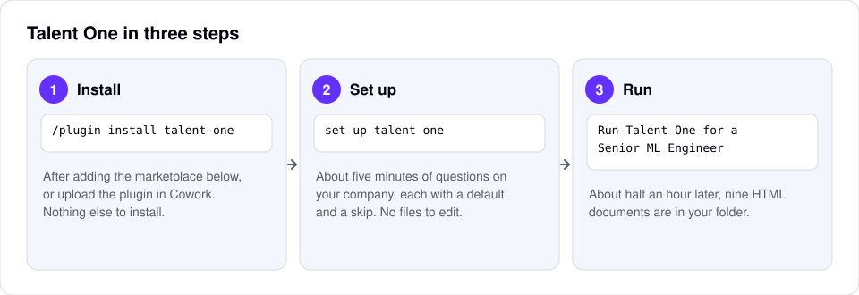
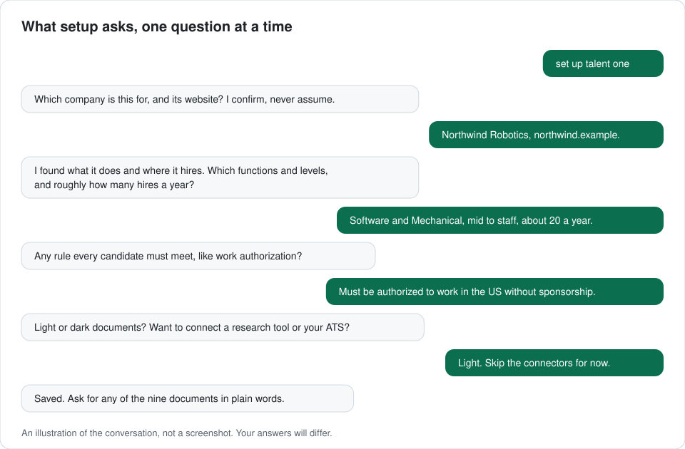
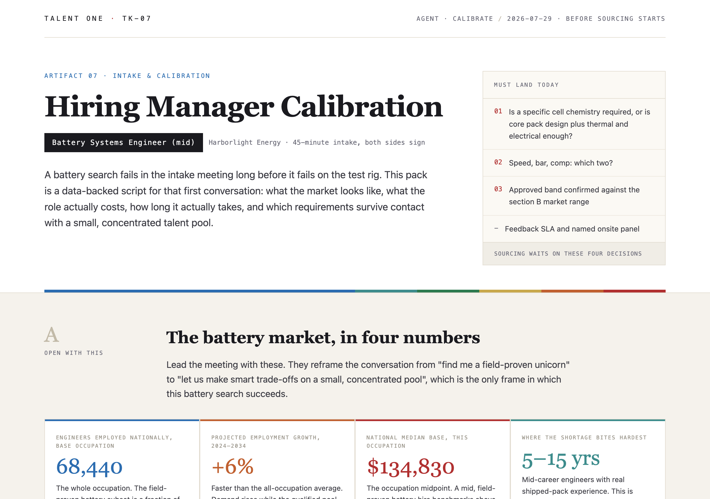
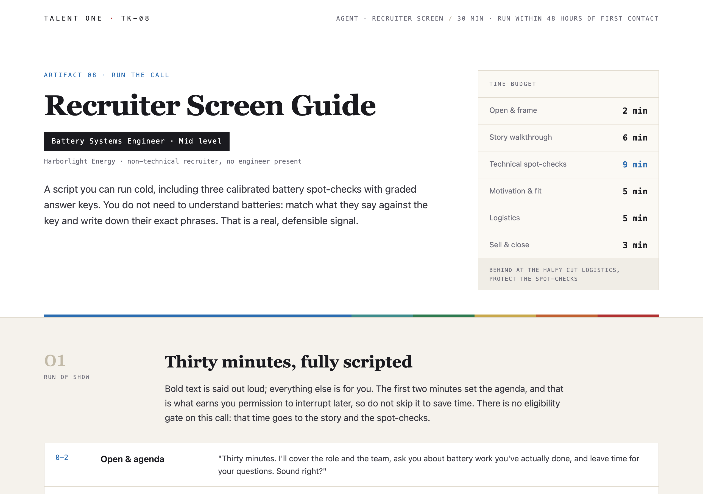
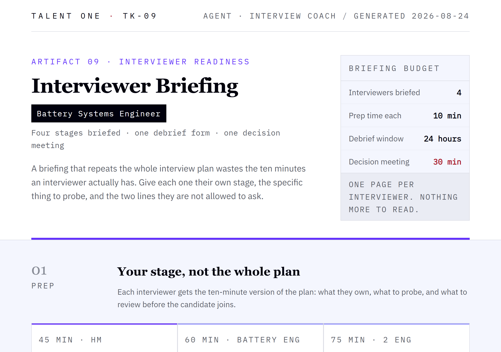
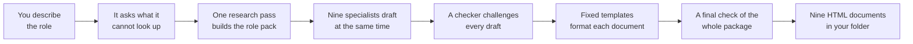

<div align="center">

# Talent One

**For recruiters and talent teams opening a role:** describe the role once and get nine ready-to-use hiring documents, from the job description to the interview plan.

[](CHANGELOG.md)
[](#get-started)
[](#license)

by [OnePromptMan](https://github.com/onepromptman)

</div>


<sub>Made from a fictional search. Your documents arrive as HTML files you open in any browser, offline.</sub>

Agent pack (Claude plugin) · No coding · Live · MIT

## What you get

- **Nine hiring documents for one role.** A role brief for you, the job description, a talent map, a sourcing playbook, outreach, an interview plan, a hiring-manager brief, a screen script and an interviewer briefing.
- **Facts you can check.** Every market figure says where it came from, and a separate checker challenges every draft before you see it.
- **Drafts only.** It never sends outreach, posts a job or writes to your ATS. You decide what to share.

## Get started



1. **Install.** In Claude Code, paste these two lines:
   ```
   /plugin marketplace add onepromptman/Talent-One
   /plugin install talent-one@talent-one
   ```
   In Cowork (the Claude desktop app), [upload the plugin](#upload-the-plugin-in-cowork) instead.
2. **Set up.** Type `set up talent one`. Five questions about your company, each with a default and
   a skip. About five minutes, less if another kit already ran setup: the profile is
   shared. Per-surface steps, uninstall, and upgrading from Talent One 1.x:
   [docs/INSTALL.md](docs/INSTALL.md).
3. **Run.** Ask `Run Talent One for a Senior ML Engineer`. It asks only what it cannot look up,
   then works for about half an hour. Open the nine HTML documents in your working folder.

For one document, ask `Write me a JD for a staff accountant`. `Update the comp band to
$180k-$220k` re-renders in about a second.

**What you need:** Claude Code or Cowork, and Python 3.10 or later where the plugin runs.
No API key and nothing else to install. It does not run in the regular Claude or ChatGPT
chat window, because only Claude Code and Cowork can start its helper agents.

### Upload the plugin in Cowork

1. Download this repository (Code, then Download ZIP) and unzip it.
2. Open the plugin folder, the one whose `.claude-plugin` folder holds `plugin.json`, and
   zip its contents so that `.claude-plugin/plugin.json` sits at the top of the zip. On macOS or Linux, from
   inside that folder:

   ```sh
   zip -r ../talent-one.zip .
   ```

   In Windows PowerShell, from inside that folder:

   ```powershell
   Compress-Archive -Path .\* -DestinationPath ..\talent-one.zip
   ```

3. In the Claude desktop app open Customize, then Plugins, then Add, then Upload plugin,
   and choose the zip.

## Make each document your own

Every document is a complete first draft, not a finished one. Before you post, send or
share one, check what only your company knows: your company description and proof points,
the pay range you are approved to post, your real interview stages and who runs them,
your benefits and equal opportunity wording, and every figure marked **Estimate**. The job
description, interview plan, outreach campaign and interviewer briefing need the most work.

You do not have to do this alone. After a run, or any time, ask
`Help me customize my JD` (or "my documents"). Talent One goes through each document in
plain words: what it is for, what to check, which lines came from your company, and which
figures are estimates. Tell it what to change and it updates and re-renders every document that
repeats that fact. You never edit a file.

## Setup is a conversation



Setup confirms your company and its website, looks up what it can, then asks what you
hire, any rule every candidate must meet, how the documents should look and whether to
connect a research tool or your ATS. Every question except the company has a default and a
skip. Connectors sign in through your browser; setup never asks for a key and never asks
you to edit a file. Your answers are saved in `onepromptman-profile.md` in your working
folder, which the other OnePromptMan kits share.

## See it before you install

Download this repository as a ZIP, unzip it, and open any file in `samples/` in your
browser, for example `samples/02_Job_Description_SAMPLE.html`. They are all nine documents
from a fictional search and need no account.

<table>
<tr>
<td width="33%"><br><sub><b>Role brief</b> for the recruiter</sub></td>
<td width="33%"><br><sub><b>Job description</b>, with notes on each choice</sub></td>
<td width="33%"><br><sub><b>Talent map</b>: where the people are</sub></td>
</tr>
<tr>
<td width="33%"><br><sub><b>Sourcing playbook</b></sub></td>
<td width="33%"><br><sub><b>Outreach</b>: email, LinkedIn, phone</sub></td>
<td width="33%"><br><sub><b>Interview plan</b> with scoring guides</sub></td>
</tr>
<tr>
<td width="33%"><br><sub><b>Hiring-manager brief</b></sub></td>
<td width="33%"><br><sub><b>Screen script</b> for the first call</sub></td>
<td width="33%"><br><sub><b>Interviewer briefing</b> and debrief form</sub></td>
</tr>
</table>

The [fictional first-run checks](docs/ACCEPTANCE.md) show what a passing run should
produce.

## How it works



A full nine-document run takes about half an hour and a couple of dozen model calls on
your plan; one document takes minutes. The call-by-call breakdown is in
[docs/how-it-works.md](docs/how-it-works.md#model-tiers-and-cost).

## What it asks of your data

- What you type and the research it runs pass through your Claude session (Anthropic).
  Connectors get only what an agent asks for, after you sign in.
- The documents are about the role, not about candidates. If you paste candidate or
  employee details, they are personal data: share only what the role needs.
- The profile, research pack and documents stay in your working folder until you
  delete them.
- Optional connectors: Exa or Bright Data (web research), Greenhouse or Ashby (your ATS).
  Nothing is sent to one until you sign in. See [CONNECTORS.md](CONNECTORS.md).

## If something goes wrong

- **`set up talent one` does nothing.** You are in the regular chat window. Use Claude Code
  or Cowork.
- **The first render stops and says Python is missing or too old.** Install Python 3.10 or
  later from python.org, then ask again.
- **The final check returns a document.** Its finding names the agent and the fix. Ask for
  the fix and that agent patches its draft.

## Run it without opening a chat

A headless runner (`runner/`) runs the same pipeline from a terminal for a scripted or
scheduled run, with the `claude` CLI signed in. It is for people comfortable with a
terminal; see [runner/README.md](runner/README.md).

<details>
<summary><b>For engineers</b></summary>

### Settings

| Setting | Default | What it does |
| --- | --- | --- |
| `onepromptman-profile.md` | written by setup | Company, roles, constraints and brand, shared by every kit |
| Document prefix | `TK` | Code on each document (`TK-01` to `TK-09`); set it in setup's Brand step |
| Footer credit | on | "Built with Talent One by OnePromptMan"; setup can turn it off |
| `.mcp.json` | four connectors, signed out | Exa, Bright Data, Greenhouse, Ashby |
| `LOG_LEVEL`, `LOG_FORMAT`, `LOG_FILE` | `WARNING`, text, standard error | What the scripts log, and where |

### Troubleshooting

Scripts log to standard error, or to `LOG_FILE`; `LOG_LEVEL=DEBUG` shows each step. The
renderer's one package, beautifulsoup4, ships inside the plugin in
`skills/talent-one/scripts/_vendor/` (version, licence and the two small edits are in its
README), so nothing is installed at run time.

### Build and test

This repository is generated from the talent-one module of onepromptman/talentai by that
repository's `tools/publish_talent_one.py`, and is never edited by hand: change the module
there and publish again. Issues are welcome here.

```bash
python3 -m venv .venv && . .venv/bin/activate
python -m pip install -r requirements-dev.txt ruff==0.17.3
python -m pytest -q
```

```bash
bash evals/run_gate.sh      # acceptance gate: briefs, context budget, lint, render + verify x9, hygiene
bash build-plugin.sh        # dist/talent-one-<version>.plugin, from committed files only
```

On Windows, run the gate from Git Bash with `PYTHONUTF8=1` set, so the verifier's JSON is
written as UTF-8.

The version is in `.claude-plugin/plugin.json` and `MODULE.yaml`; changes are in
[CHANGELOG.md](CHANGELOG.md). Agents, model tiers, layout and the sample gallery:
[docs/how-it-works.md](docs/how-it-works.md). The profile file's shape is in
[PROFILE-SPEC.md](PROFILE-SPEC.md).

</details>

## License

MIT, Copyright (c) 2026 OnePromptMan. Every document the kit generates is yours. They
are drafts for professional review, not legal advice: compensation, eligibility and
compliance language must be checked by the people responsible for them. Questions or
bugs? Open an issue.
