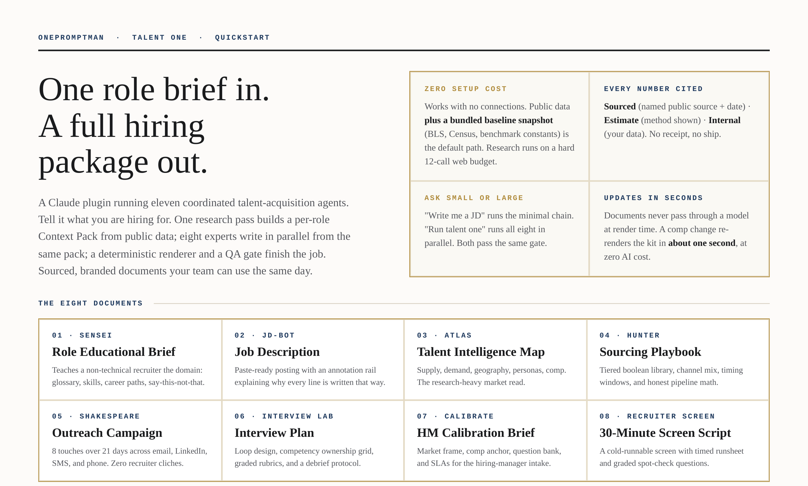
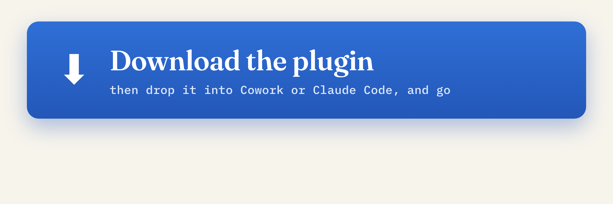
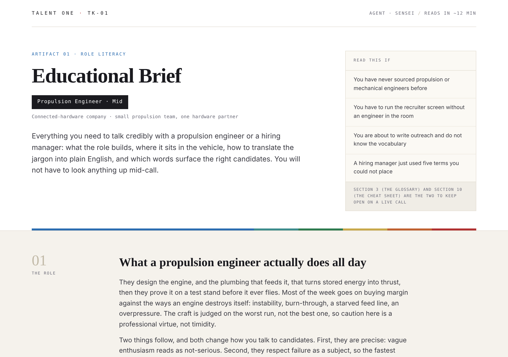
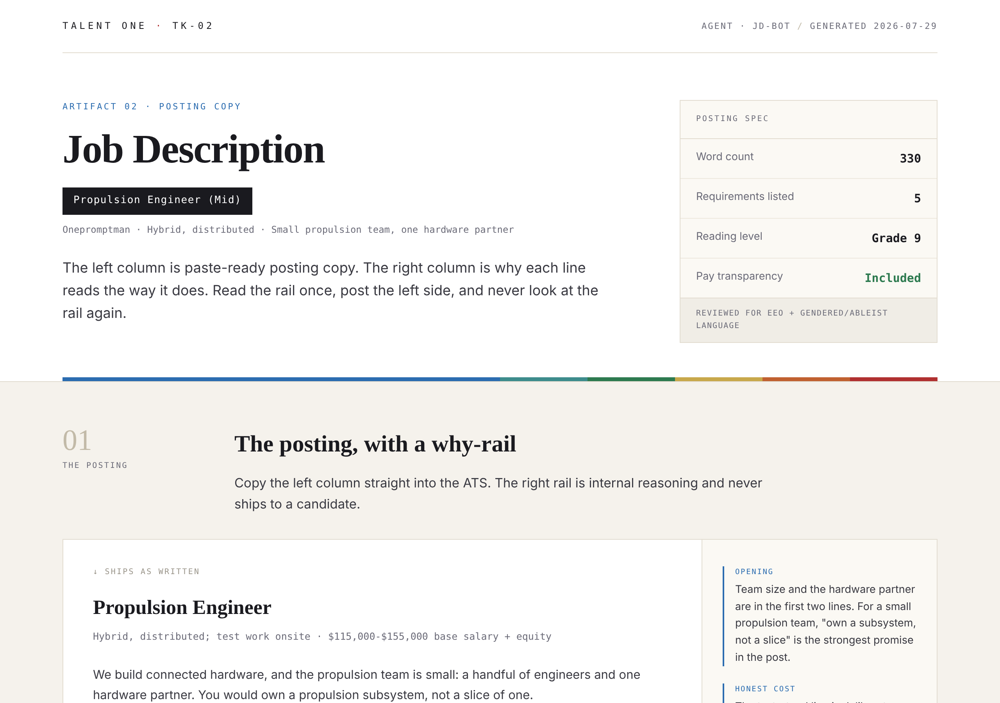
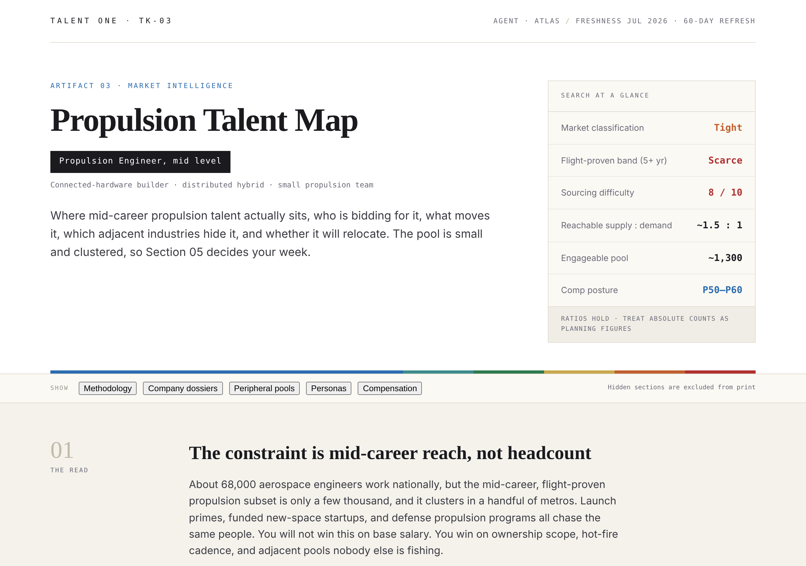
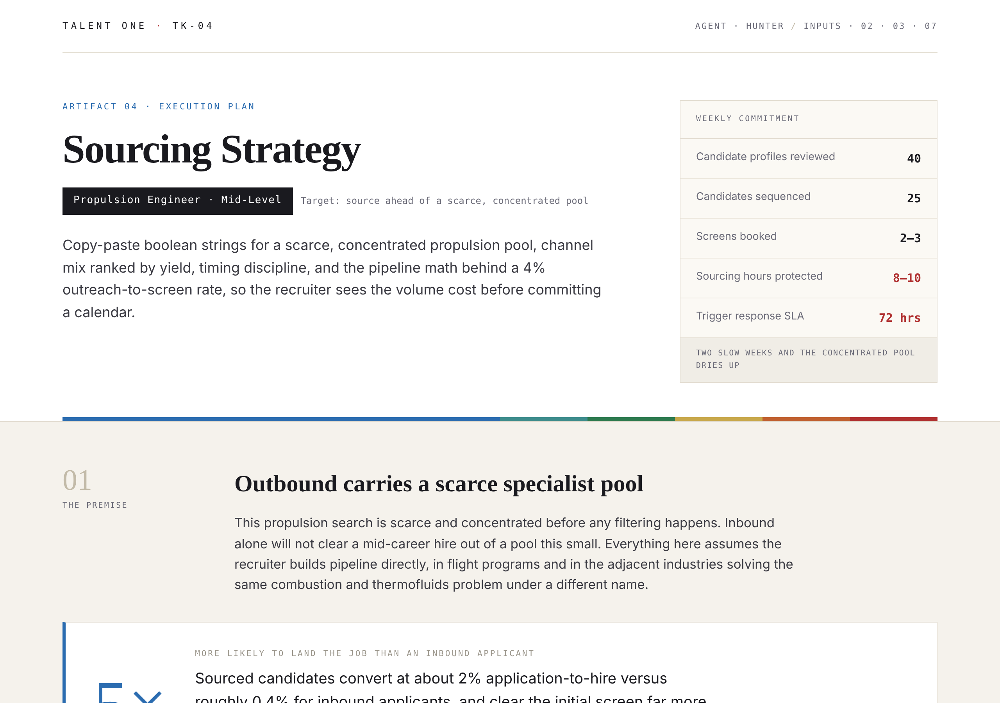
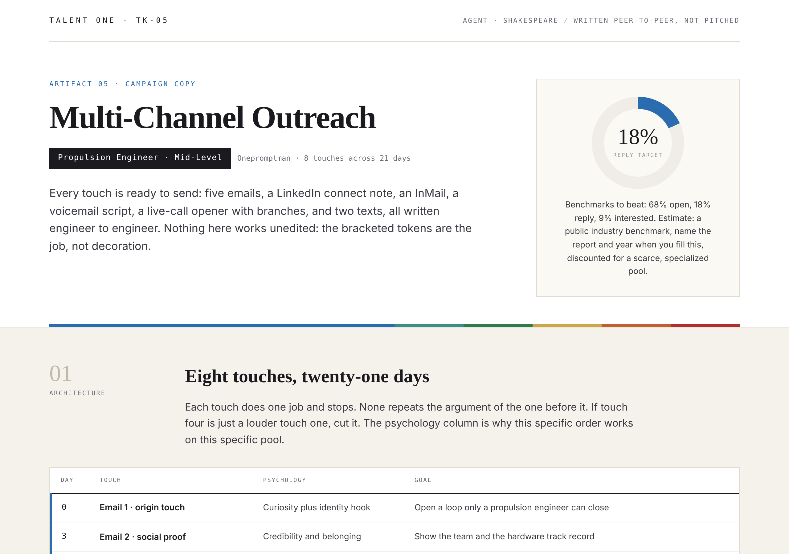
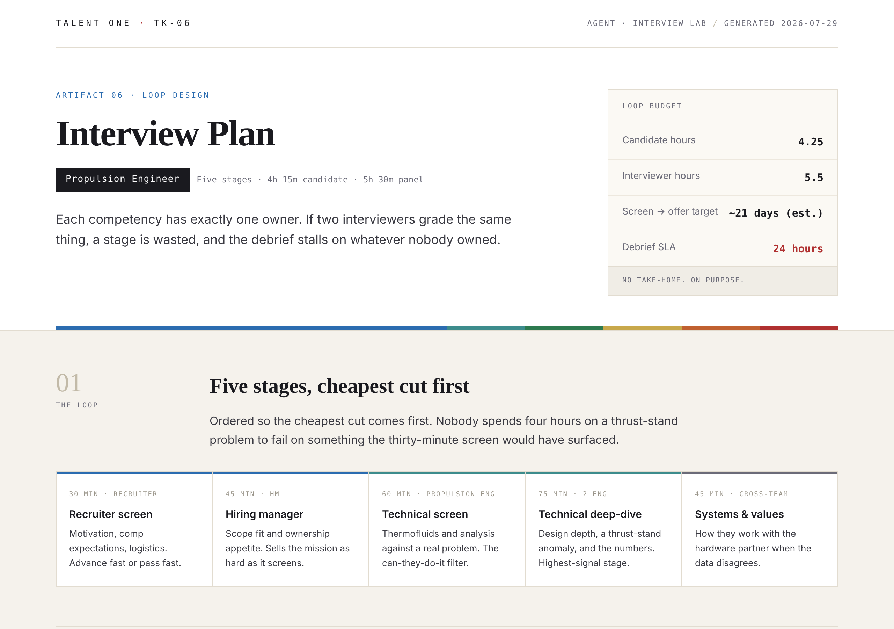
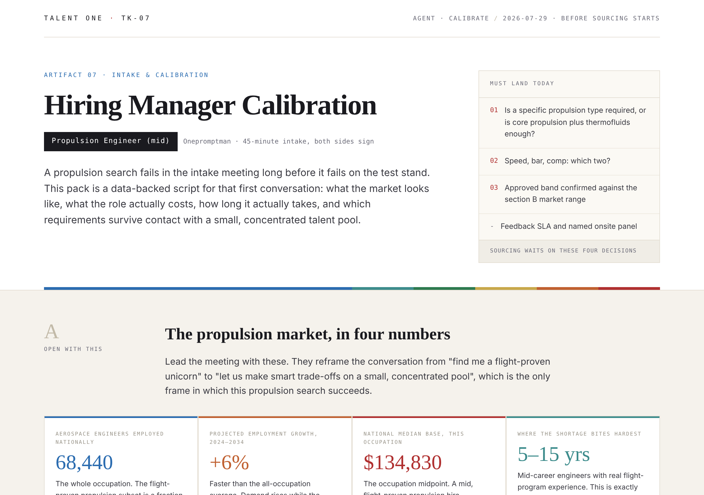
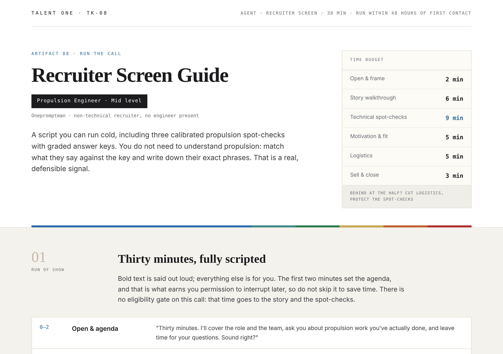

<div align="center">

# Talent One

**Tell it the role you are hiring for. Get back eight ready-to-use hiring documents.**

[](CHANGELOG.md)
[](#where-it-runs)
[](LICENSE.md)

by [Onepromptman](https://github.com/onepromptman) · © 2026

</div>



<a id="where-it-runs"></a>

> ### ⚠️ Where it runs
>
> Talent One works in **Cowork** (the Claude desktop app) and in **Claude Code**.
>
> It does **not** work in the regular Claude chat window. If you type `set up talent one` and nothing happens, you are in the chat window: open Cowork or Claude Code instead.

---

## Get it in two minutes

**1. Download the plugin** and add it as a plugin in Cowork or Claude Code.

<p align="center">
  <a href="https://github.com/onepromptman/Talent-One/raw/main/dist/talent-one-1.1.3.plugin">
    
  </a>
</p>

<p align="center"><sub>Downloads <code>talent-one-1.1.3.plugin</code> · the same file is attached to the <a href="https://github.com/onepromptman/Talent-One/releases/latest">latest release</a></sub></p>

Comfortable typing commands? Install from the marketplace instead, two lines:

```
/plugin marketplace add onepromptman/talent-one
/plugin install talent-one@onepromptman
```

**2. Introduce your company, once.** Type:

```
set up talent one
```

A few questions about your company, each with a default and a skip. About five minutes.

**3. Ask for what you need, in plain words:**

| You say | You get |
| --- | --- |
| `Run Talent One for a Senior ML Engineer` | The full eight-document kit, research and quality check included, ~30 min |
| `Write me a JD for a staff accountant` | One document, minutes |
| `Update the comp band to $180k–$220k` | Re-rendered in about a second |

## What you get

Eight documents, each one a single file that opens in any browser. These samples come from one `Propulsion Engineer` run for a fictional company, using public labor-market data. Click a preview to open the full document.

<table>
<tr>
<td width="50%"><a href="samples/01_Role_Educational_Brief_SAMPLE.html"></a><br><sub><b>01 · Role educational brief</b> · learn the role's language before your first call</sub></td>
<td width="50%"><a href="samples/02_Job_Description_SAMPLE.html"></a><br><sub><b>02 · Job description</b> · ready to post, with a note on why each line is there</sub></td>
</tr>
<tr>
<td width="50%"><a href="samples/03_Talent_Intelligence_Map_SAMPLE.html"></a><br><sub><b>03 · Talent map</b> · where these people work, who else wants them, what they earn</sub></td>
<td width="50%"><a href="samples/04_Sourcing_Playbook_SAMPLE.html"></a><br><sub><b>04 · Sourcing playbook</b> · search strings to paste, where to look, how many to contact</sub></td>
</tr>
<tr>
<td width="50%"><a href="samples/05_Outreach_Campaign_SAMPLE.html"></a><br><sub><b>05 · Outreach campaign</b> · eight messages to send by email, LinkedIn, phone, and text</sub></td>
<td width="50%"><a href="samples/06_Interview_Plan_SAMPLE.html"></a><br><sub><b>06 · Interview plan</b> · who asks what, and how to score the answers</sub></td>
</tr>
<tr>
<td width="50%"><a href="samples/07_HM_Calibration_Brief_SAMPLE.html"></a><br><sub><b>07 · Hiring-manager brief</b> · your agenda for the intake meeting, with the market and pay facts</sub></td>
<td width="50%"><a href="samples/08_Recruiter_Screen_Script_SAMPLE.html"></a><br><sub><b>08 · Recruiter screen script</b> · a 30-minute phone screen you can run without an expert</sub></td>
</tr>
</table>

> Previews are screenshots. GitHub shows `.html` files as code, so to see the real document use the raw/download view or clone the repo, then open the file in a browser.

On a full run, a final quality check reads all eight documents against each other before anything is called done.

## Honest limits

- **It runs on public data** unless you connect your own tools. That is a fully supported way to use it, not a lesser one.
- **Every number says where it came from:** **Sourced** (a named public source and date), **Estimate** (the method is shown), or **Internal** (your own data). Missing data is labeled as missing, never made up.
- **Everything it writes is a draft for professional review.** Nothing it produces is legal advice. Pay, eligibility, and compliance wording must be checked by the people who own those decisions.
- **Nothing is sent anywhere by the plugin.** Each document is a single file that makes no network requests, and your company profile and role folders stay on your machine. Research uses the web search of the Claude app you run it in, plus any connector you choose to sign in to.

---

## How it works

One research pass per role builds a **Context Pack** (a shared research summary for the role): market classification, one canonical comp range, requirements, keywords, personas, channels, targets, and timing, each value tagged with where it came from.

Then every requested artifact agent runs **in parallel** against that pack, producing content only. The finished documents are assembled from fixed templates (not generated by a model), so the formatting is always consistent. A QA gate checks the content against the pack before anything is called done.

```
role brief ──▶ Relay (plan) ──▶ Scout (one research pass ──▶ Context Pack)
                                          │
                    ┌─────────────────────┼─────────────────────┐
                    ▼                     ▼                     ▼
                 Sensei · JD-Bot · Atlas · Hunter · Shakespeare ·
                 Interview Lab · Calibrate · Recruiter Screen     (parallel)
                    └─────────────────────┬─────────────────────┘
                                          ▼
                        deterministic renderer ──▶ QA Gate ──▶ 8 HTML documents
```

| # | Artifact | Agent | Sample |
| --- | --- | --- | --- |
| 01 | Role educational brief (for non-technical recruiters) | Sensei | [view](samples/01_Role_Educational_Brief_SAMPLE.html) |
| 02 | Job description with annotation rail | JD-Bot | [view](samples/02_Job_Description_SAMPLE.html) |
| 03 | Talent intelligence map · supply, demand, geo, comp | Atlas | [view](samples/03_Talent_Intelligence_Map_SAMPLE.html) |
| 04 | Sourcing playbook with tiered boolean library | Hunter | [view](samples/04_Sourcing_Playbook_SAMPLE.html) |
| 05 | Multi-channel outreach campaign (8 touches) | Shakespeare | [view](samples/05_Outreach_Campaign_SAMPLE.html) |
| 06 | Interview plan with graded rubrics | Interview Lab | [view](samples/06_Interview_Plan_SAMPLE.html) |
| 07 | Hiring-manager calibration brief | Calibrate | [view](samples/07_HM_Calibration_Brief_SAMPLE.html) |
| 08 | 30-minute recruiter screen script | Recruiter Screen | [view](samples/08_Recruiter_Screen_Script_SAMPLE.html) |
| - | QA audit of the whole package | QA Gate | - |

**Relay** (plans the run) and **Scout** (builds the shared per-role research pack) run automatically behind every artifact above. You never invoke them directly. Every artifact is self-contained HTML with zero network requests, and the renderer stamps the same masthead, artifact id, and footer on all eight.

**Timing:** full kit ≈ 30 minutes cold (measured live). One artifact on a warm role: minutes. Changing a number later re-renders in seconds.

Anything you already hold (a JD, intake notes, comp data, a brain dump) shortens the pack build. Technical users who already run deep research in another Claude chat can use a paste-ready prompt (`skills/talent-one/references/PACK_RESEARCH_PROMPT.md`) to build the pack there and hand it in as a file.

## Data and connectors

Works with **zero connections**, using public data: BLS, O\*NET, Census, DOL disclosure data, levels.fyi, live web search. That is a fully supported path, not a degraded mode.

Four connectors ship inside the plugin, none required, each signed in once with OAuth: **Exa** (web research), **Bright Data** (search results and page reads behind bot protection), and the official **Greenhouse** and **Ashby** MCP servers. Agents read ATS pipelines as counts; Ashby writes and candidate reads are outside what agents can call, and Greenhouse stays read-only through your admin's scopes. Your own document store or ATS connector is read at intake in your main session and filed where every agent can read it. See [CONNECTORS.md](CONNECTORS.md).

Constraints (work authorization, clearance, licensure) are recruiter-written, rendered verbatim, and never invented. An empty constraints list ships no eligibility gate at all.

## Privacy

The plugin itself sends nothing anywhere: the renderer and the scripts make no network calls, and every generated document is self-contained. Research traffic goes through the web tools of the Claude surface you run it in. The four bundled connectors (Exa, Bright Data, Greenhouse, Ashby) are third-party services, each under its own privacy policy; none receives anything until you sign in, and the plugin stores no API key. The agents reach only those four servers plus the built-in web tools, never your other connectors; what they may read, and what they may never pass on, is set out in [CONNECTORS.md](CONNECTORS.md). Your profile, role folders, and packs stay on your machine.

## Is it safe to install?

The plugin is plain text: prompts, templates, three small Python scripts, and a list of four optional remote connectors (see [CONNECTORS.md](CONNECTORS.md)) that do nothing until you sign in. In Claude Code the scripts run as ordinary commands on your machine (the first render may `pip install beautifulsoup4`); in Cowork they run in Cowork's sandbox. They make no network calls and nothing reports back to anyone. The whole source is in this repo, so read it. `bash evals/run_gate.sh` runs the acceptance gate on the kit's own worked examples.

Verify your download is the official build: run `sha256sum talent-one-1.1.3.plugin` and compare with the expected hash in [docs/INSTALL.md](docs/INSTALL.md) or the `.sha256` file beside the build in [`dist/`](dist/). The hash lives outside the archive because the archive contains this README. Older builds stay in `dist/`, each with its own `.sha256` file.

## Repository layout

```
.claude-plugin/     plugin.json + marketplace.json
.mcp.json           the four optional bundled connectors
agents/             the 11 agent definitions
skills/             11 skills: the full kit plus one per artifact
samples/            all 8 documents from the built-in worked example
assets/             README images and sample screenshots
docs/               quickstart PDF, one-pager PDF, install guide, release notes
evals/              acceptance gate (run_gate.sh) on the kit's own worked examples
dist/               packaged .plugin builds (1.0.3 to 1.1.3), sha256 beside each
build-plugin.sh     packages a new build into dist/ without overwriting an old one
```

## Docs

- [Install guide](docs/INSTALL.md) · per-surface steps, uninstall, and the sha256 table
- [Quickstart (PDF)](docs/TalentOne_Quickstart.pdf) · 3 pages: what it is, how it works, setup. made for 1.0; the overview and setup steps still apply, and the install guide has the current details
- [One-pager (PDF)](docs/TalentOne_OnePager.pdf) · made for 1.0.3; the overview still holds
- [Release notes 1.1.3](docs/RELEASE_NOTES_1.1.3.md) · [Changelog](CHANGELOG.md)
- Older builds: release notes [1.1.2](docs/RELEASE_NOTES_1.1.2.md) · [1.1.1](docs/RELEASE_NOTES_1.1.1.md) · [1.1.0](docs/RELEASE_NOTES_1.1.0.md) · [1.0.3](docs/RELEASE_NOTES_1.0.3.md); the builds themselves stay in [`dist/`](dist/)
- [Connectors](CONNECTORS.md)

## License

Source-available, not open source. You may install it, run it for your own org or your clients, customize it, and use or publish every artifact it generates: those are yours. You may not resell or redistribute the kit itself. Full terms in [LICENSE.md](LICENSE.md).

Artifacts are drafts for professional review. Nothing the kit produces is legal advice; compensation, eligibility, and compliance language must be reviewed by the people responsible for those decisions at your organization.

---

Questions, bugs, or want a kit run on a live role? Open an issue, or find **Bryan (Onepromptman)** on LinkedIn.
