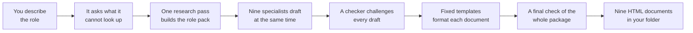
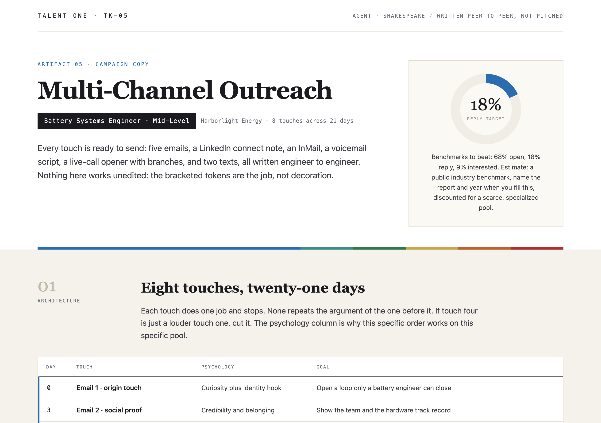
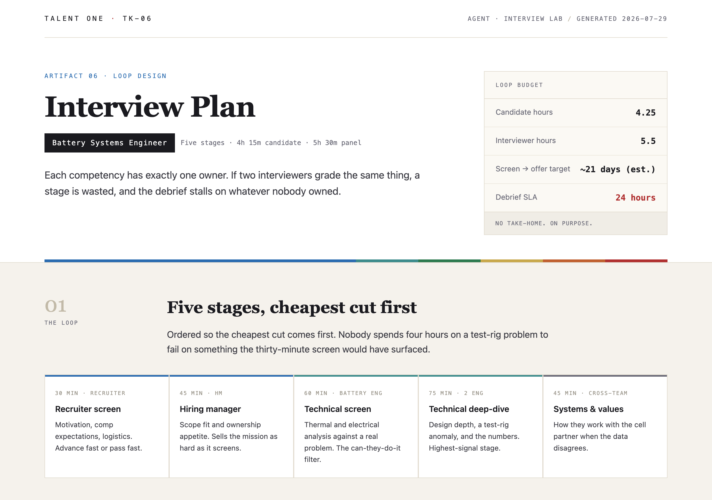

<div align="center">

# Talent One

**For recruiters and talent teams opening a role:** describe the role once and get nine ready-to-use hiring documents, from the job description to the interview plan.

[](CHANGELOG.md)
[](#where-it-runs)
[](#license)

by [OnePromptMan](https://github.com/onepromptman)

</div>


Agent pack (Claude plugin) · No coding · In prep · MIT

## Where it runs

Claude Code or Cowork (the Claude desktop app) only. The regular chat window cannot
start the kit's helper agents.

You'll need:

- A Claude plan that includes Claude Code or Cowork. Nothing else: the kit works on
  public data.
- Time and model use on your plan. A full nine-document run takes about half an hour
  and a couple of dozen model calls; one document takes minutes. The call-by-call
  breakdown is in [docs/how-it-works.md](docs/how-it-works.md#model-tiers-and-cost).
- Optional: Exa or Bright Data (web research), Greenhouse or Ashby (your ATS). Nothing
  is sent to one until you sign in. See [CONNECTORS.md](CONNECTORS.md).

## How it works



## What you get

Eight of the nine documents, from a fictional search for a Battery Systems Engineer.
They open in any browser, offline.

<table>
<tr>
<td width="25%"><br><sub><b>Role brief</b> for the recruiter</sub></td>
<td width="25%"><br><sub><b>Job description</b>, with notes on each choice</sub></td>
<td width="25%"><br><sub><b>Talent map</b>: where the people are</sub></td>
<td width="25%"><br><sub><b>Sourcing playbook</b></sub></td>
</tr>
<tr>
<td width="25%"><br><sub><b>Outreach</b>: email, LinkedIn, phone</sub></td>
<td width="25%"><br><sub><b>Interview plan</b> with scoring guides</sub></td>
<td width="25%"><br><sub><b>Hiring-manager brief</b></sub></td>
<td width="25%"><br><sub><b>Screen script</b> for the first call</sub></td>
</tr>
</table>

## First run

1. Open Claude Code or Cowork and add the plugin:
   ```
   /plugin marketplace add onepromptman/Talent-One
   /plugin install talent-one@talent-one
   ```
2. Type `set up talent one`. Five questions about your company, each with a default and
   a skip. About five minutes, less if another kit already ran setup: the profile is
   shared. Per-surface steps, uninstall, and upgrading from Talent One 1.x:
   [docs/INSTALL.md](docs/INSTALL.md).
3. Ask `Run Talent One for a Senior ML Engineer`. It asks only what it cannot look up,
   then works for about half an hour.
4. Open the nine HTML documents in your working folder. They open in any browser,
   offline. The [sample gallery](docs/how-it-works.md#sample-gallery) shows eight, from a
   fictional search.

For one document, ask `Write me a JD for a staff accountant`. `Update the comp band to
$180k-$220k` re-renders in about a second. Talent One drafts only: it never sends
outreach, posts a job or writes to your ATS.

## What it asks of your data

- What you type and the research it runs pass through your Claude session (Anthropic).
  Connectors get only what an agent asks for, after you sign in.
- The documents are about the role, not about candidates. If you paste candidate or
  employee details, they are personal data: share only what the role needs.
- The profile, research pack and documents stay in your working folder until you
  delete them.

## Settings

| Setting | Default | What it does |
| --- | --- | --- |
| `onepromptman-profile.md` | written by setup | Company, roles, constraints and brand, shared by every kit |
| Document prefix | `TK` | Code on each document (`TK-01` to `TK-09`); set it in setup's Brand step |
| Footer credit | on | "Built with Talent One by OnePromptMan"; setup can turn it off |
| `.mcp.json` | four connectors, signed out | Exa, Bright Data, Greenhouse, Ashby |
| `LOG_LEVEL`, `LOG_FORMAT`, `LOG_FILE` | `WARNING`, text, standard error | What the scripts log, and where |

## When something goes wrong

- `set up talent one` does nothing: you are in the regular chat window. Use Claude Code
  or Cowork.
- The first render stops on a missing package: run `python3 -m pip install
  beautifulsoup4`, then ask again.
- The final check returns a document: its finding names the agent and the fix. Ask for
  the fix and that agent patches its draft. Scripts log to standard error, or to
  `LOG_FILE`; `LOG_LEVEL=DEBUG` shows each step.

## For maintainers

This repository is generated from the talent-one module of onepromptman/talentai by that
repository's `tools/publish_talent_one.py`, and is never edited by hand: change the module
there and publish again. Issues are welcome here.

```bash
python3 -m venv .venv && . .venv/bin/activate
python -m pip install -r requirements-dev.txt ruff==0.17.3
python -m pytest -q
```

```bash
bash evals/run_gate.sh      # acceptance gate: briefs, context budget, lint, render + verify x9, hygiene
bash build-plugin.sh        # dist/talent-one-<version>.plugin, from committed files only
```

The version is in `.claude-plugin/plugin.json` and `MODULE.yaml`; changes are in
[CHANGELOG.md](CHANGELOG.md). Agents, model tiers, layout and the sample gallery:
[docs/how-it-works.md](docs/how-it-works.md).

## License

MIT, Copyright (c) 2026 OnePromptMan. Every document the kit generates is yours. They
are drafts for professional review, not legal advice: compensation, eligibility and
compliance language must be checked by the people responsible for them. Questions or
bugs? Open an issue.
