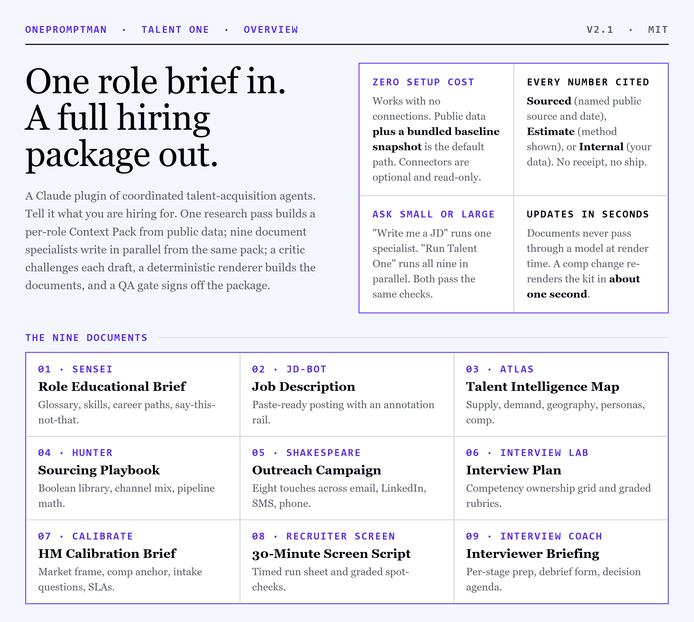
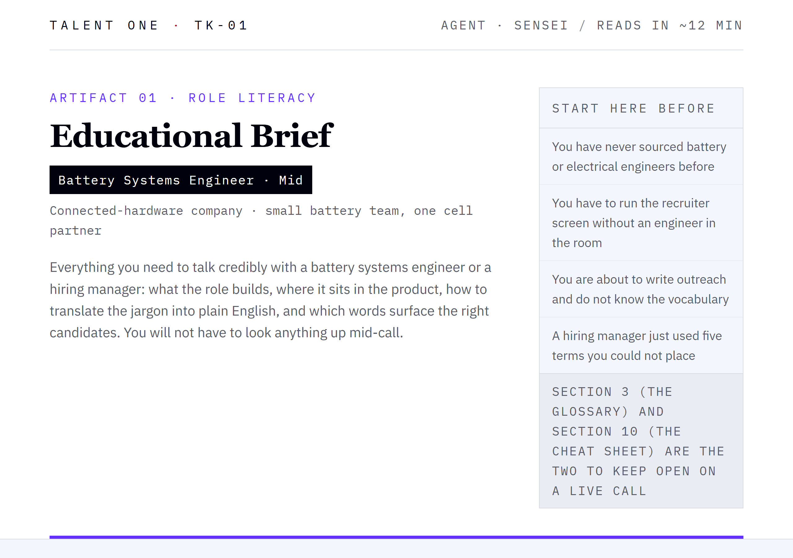
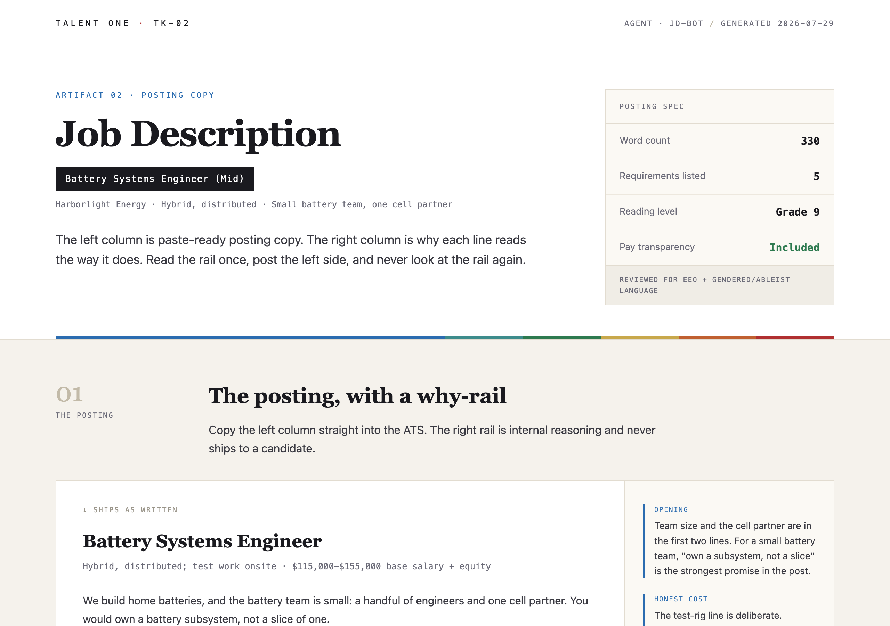
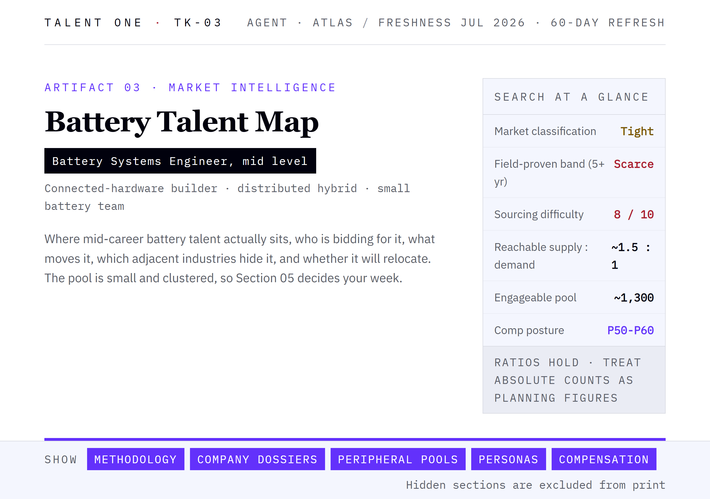
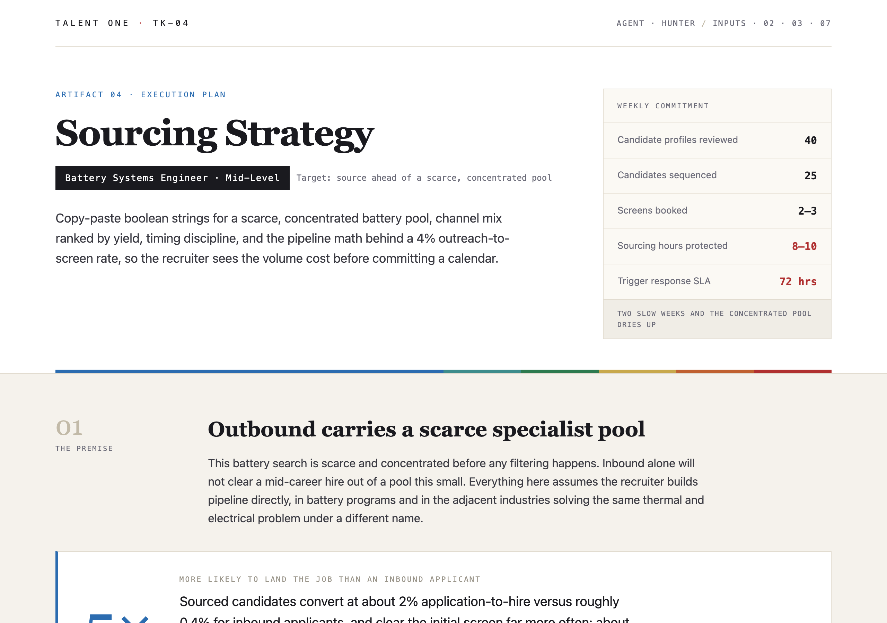

<div align="center">

# Talent One

**Install the plugin, open Cowork or Claude Code, and go.** A team of talent-acquisition agents turns one role brief into a full nine-document hiring kit.

[](CHANGELOG.md)
[](#where-it-runs)
[](#license)

by [OnePromptMan](https://github.com/onepromptman) · built from the talent-one module of onepromptman/talentai

</div>



---

> ### Where it runs
>
> Talent One runs in **Claude Code** and **Cowork** (the Claude desktop app).
>
> It does **not** run in the regular Claude chat window. Chat cannot spawn the kit's
> sub-agents, so `set up talent one` silently does nothing there. If nothing happens
> when you try it, you are in the wrong surface.

---

## Install

```
/plugin marketplace add onepromptman/Talent-One
/plugin install talent-one@talent-one
```

Then, once:

```
set up talent one
```

Five questions about your company, every one with a default and a skip. About five
minutes, less if another OnePromptMan kit already ran setup: the profile is shared.
Per-surface steps, connectors, uninstall, and upgrading from Talent One 1.x are in
[docs/INSTALL.md](docs/INSTALL.md).

Then just ask, in plain words:

| You say | You get |
| --- | --- |
| `Run Talent One for a Senior ML Engineer` | The full nine-document kit, research and QA included, about 30 minutes |
| `Write me a JD for a staff accountant` | One document, minutes |
| `Update the comp band to $180k-$220k` | Re-rendered in about a second |

## What it makes

| # | Artifact | Agent | Sample |
| --- | --- | --- | --- |
| 01 | Role educational brief (for non-technical recruiters) | Sensei | [view](samples/01_Role_Educational_Brief_SAMPLE.html) |
| 02 | Job description with annotation rail | JD-Bot | [view](samples/02_Job_Description_SAMPLE.html) |
| 03 | Talent intelligence map: supply, demand, geography, comp | Atlas | [view](samples/03_Talent_Intelligence_Map_SAMPLE.html) |
| 04 | Sourcing playbook with tiered boolean library | Hunter | [view](samples/04_Sourcing_Playbook_SAMPLE.html) |
| 05 | 8-touch multi-channel outreach campaign | Shakespeare | [view](samples/05_Outreach_Campaign_SAMPLE.html) |
| 06 | Interview plan with graded rubrics | Interview Lab | [view](samples/06_Interview_Plan_SAMPLE.html) |
| 07 | Hiring-manager calibration brief | Calibrate | [view](samples/07_HM_Calibration_Brief_SAMPLE.html) |
| 08 | 30-minute recruiter screen script | Recruiter Screen | [view](samples/08_Recruiter_Screen_Script_SAMPLE.html) |
| 09 | Interviewer briefing and debrief | Interview Coach | not yet in the gallery |
| - | QA audit of the whole package | QA Gate | - |

**Relay** runs the whole loop: it plans, spawns **Scout** (the shared per-role research
pack), spawns every artifact agent above in parallel, spawns **Critic** to challenge
each draft, renders and verifies deterministically, then spawns **QA Gate** across the
finished package. You never invoke Relay, Scout, Critic, or QA Gate directly.

Every artifact is a polished, self-contained HTML document: zero network requests,
opens anywhere, reads on a phone. Every number is tagged with where it came from:
**Sourced**, **Estimate**, or **Internal**. Nothing is fabricated; gaps are labeled,
never filled with filler.

### Sample gallery

Eight documents rendered from the kit's built-in worked example: a fictional search
for a Battery Systems Engineer at a fictional home-battery company, Harborlight
Energy. The company, the search, and its figures are illustrative, not current market
data. Click any preview to open the full HTML.

<table>
<tr>
<td width="50%"><a href="samples/01_Role_Educational_Brief_SAMPLE.html"></a><br><sub><b>01 · Role educational brief</b> · Sensei</sub></td>
<td width="50%"><a href="samples/02_Job_Description_SAMPLE.html"></a><br><sub><b>02 · Job description + annotation rail</b> · JD-Bot</sub></td>
</tr>
<tr>
<td width="50%"><a href="samples/03_Talent_Intelligence_Map_SAMPLE.html"></a><br><sub><b>03 · Talent intelligence map</b> · Atlas</sub></td>
<td width="50%"><a href="samples/04_Sourcing_Playbook_SAMPLE.html"></a><br><sub><b>04 · Sourcing playbook</b> · Hunter</sub></td>
</tr>
<tr>
<td width="50%"><a href="samples/05_Outreach_Campaign_SAMPLE.html"></a><br><sub><b>05 · Multi-channel outreach campaign</b> · Shakespeare</sub></td>
<td width="50%"><a href="samples/06_Interview_Plan_SAMPLE.html"></a><br><sub><b>06 · Interview plan + graded rubrics</b> · Interview Lab</sub></td>
</tr>
<tr>
<td width="50%"><a href="samples/07_HM_Calibration_Brief_SAMPLE.html"></a><br><sub><b>07 · Hiring-manager calibration brief</b> · Calibrate</sub></td>
<td width="50%"><a href="samples/08_Recruiter_Screen_Script_SAMPLE.html"></a><br><sub><b>08 · Recruiter screen script</b> · Recruiter Screen</sub></td>
</tr>
</table>

> Previews are screenshots (`bash assets/src/screenshots.sh` rebuilds them). GitHub
> shows `.html` as source, so use the raw or download view, or clone the repo, to see
> the live document.

## How it works

One research pass per role builds a **Context Pack** (a shared research summary for the
role): market classification, one canonical comp range, requirements, keywords,
personas, channels, targets, and timing, each value tagged with where it came from.

Then every requested artifact agent runs **in parallel** against that pack, producing
content only. **Critic** runs one adversarial pass per artifact before anything renders.
The finished documents are assembled from fixed templates by a deterministic renderer
(not generated by a model), so the formatting is always consistent. **QA Gate** checks
the whole package against the pack before anything is called done. You talk to the
session skill; it calls Relay twice (`mode: plan`, then `mode: execute`), never the
workers.

```
role brief -> Relay [mode: plan] -> ask-first list -> your answers
                      |
                      v
            Relay [mode: execute]
                      |
                      v
      Scout (one research pass -> Context Pack)
                      |
    +-----------------+-----------------------------------+
    v                 v                                   v
 Sensei · JD-Bot · Atlas · Hunter · Shakespeare · Interview Lab ·
 Calibrate · Recruiter Screen · Interview Coach         (parallel, Sonnet)
    +-----------------+-----------------------------------+
                      v
        Critic per artifact (Opus) -> repair patch, at most 2 laps
                      v
        deterministic renderer -> verify
                      v
            QA Gate (Opus, 2+ artifacts) -> repair patch, at most 2 laps
                      v
              completion report -> 9 HTML documents
```

**Model tiering, and its cost.** Relay plans and runs the loop on the orchestrator tier
(Fable); every artifact agent and Scout produce on the executor tier (Sonnet); Critic and
QA Gate judge on the verifier tier (Opus), and the model that made a thing never checks
it. A cold nine-artifact run is roughly 10 Sonnet calls (Scout plus the nine producers),
11 Opus calls (one pack Critic pass, nine per-artifact Critic passes, one QA Gate pass),
and 2 Fable calls (Relay plan and execute, plus one more per question it has to bring
back to you). The extra Opus calls are where the honesty comes from: a producer that
fabricates a figure or ships a placeholder has to survive an adversarial pass on a
different model before it ever renders.

**Timing:** full kit about 30 minutes cold, dominated by Scout's research pass. One
artifact on a warm role: minutes. Changing a number later re-renders in seconds.

Anything you already hold (a JD, intake notes, comp data, a brain dump) shortens the
pack build. A paste-ready deep-research prompt
(`skills/talent-one/references/PACK_RESEARCH_PROMPT.md`) lets you build the pack in any
Claude chat and hand it in as a file.

## Data and connectors

Works with **zero connections**, using public data: BLS, O\*NET, Census, DOL disclosure
data, levels.fyi, live web search, and a bundled baseline snapshot. That is a fully
supported path, not a degraded mode.

Four optional remote connectors ship in `.mcp.json`: **Exa** and **Bright Data** for
the public web layer, **Greenhouse** and **Ashby** for your own ATS. Nothing is sent to
any of them until you sign in, and each agent may call only the tools its file names.
Setup, scopes, and privacy rules: [CONNECTORS.md](CONNECTORS.md).

Constraints (work authorization, licensure, background checks) are recruiter-written,
rendered verbatim, and never invented. An empty constraints list ships no eligibility
gate at all.

## Branding

Setup's `## Brand` section sets the artifact code prefix and the footer credit. The
renderer owns that chrome: `render.py render --prefix <code>` sets the mark and footer
(default `TK`, so documents read `TK-01` to `TK-09`), and `--credit on|off` keeps or drops
the footer credit "Built with Talent One by OnePromptMan" (default on).

## Is it safe to install?

The plugin is plain text: prompts, templates, and small Python scripts. No executables,
nothing reports back to anyone. In Cowork the scripts run inside Claude's sandbox; in
Claude Code they run on your computer through Claude's Bash tool. The renderer needs one
Python package, beautifulsoup4; the first render installs it if it is missing
(`python3 -m pip install beautifulsoup4`). A content fragment cannot carry a script, an
event handler, a remote image or a frame into a rendered document: the renderer keeps
only inline formatting, and its verify step flags any active content as HIGH. The whole
source is in this repo: read it.

## For maintainers

This repository is generated from the talent-one module of onepromptman/talentai by that
repository's `tools/publish_talent_one.py`, and is never edited by hand: change the module
there and publish again. Issues are welcome here.

```bash
bash evals/run_gate.sh      # acceptance gate: briefs, context budget, lint, render + verify x9, hygiene
bash build-plugin.sh        # dist/talent-one-<version>.plugin plus its sha256, from committed files only
```

`build-plugin.sh` is only for surfaces that take a plugin upload; the marketplace
install above needs none of it. Built plugins are not committed.

## Layout

```
.claude-plugin/     plugin.json and marketplace.json (one marketplace, named talent-one)
.mcp.json           the four optional remote connectors
agents/             agent definitions: relay, scout, the nine artifact specialists,
                    oracle, pforge, critic, qa-gate
skills/             the full kit, one skill per artifact, funnel diagnosis, setup, and
                    the QA audit
samples/            eight documents from the built-in worked example
evals/              acceptance gate and model evals
runner/             headless runner (claude -p) and the aggregate ATS fetcher
tools/              structural validators for the DAG, the fill contract and the slot schema
tests/              the renderer safety test (python -m pytest -q tests)
docs/               install guide and 1.0.3 release notes
requirements.txt    beautifulsoup4, the renderer's one Python dependency
```

## Docs

- [Install guide](docs/INSTALL.md): per-surface steps for Claude Code and Cowork
- [Connectors](CONNECTORS.md)
- [Changelog](CHANGELOG.md) and [release notes 1.0.3](docs/RELEASE_NOTES_1.0.3.md) (kept for history)

## What 2.x supersedes

Talent One 1.x, the sequential, content-in-HTML predecessor of this kit; 2.1 carries its
1.1.x features forward. This repository starts a fresh history at 2.1.0, and the 1.x
history is not part of it. The same roster also runs outside Claude Code: its paste-in
editions for Claude Projects and custom GPTs and its n8n swarm are published separately as
onepromptman/dag-talent-agents. Oracle is the `oracle` agent behind the
`talent-one-funnel` skill (its benchmark-retrieval discipline also lives in Scout), Pforge
is the `pforge` agent, and Interview Coach's seven coaching dimensions became artifact
09.

## License

MIT, Copyright (c) 2026 OnePromptMan. The full text is in the repository's license
file. Every artifact the kit generates is yours.

Artifacts are drafts for professional review. Nothing the kit produces is legal advice;
compensation, eligibility, and compliance language must be reviewed by the people
responsible for those decisions at your organization.

---

Questions, bugs, or want a kit run on a live role? Open an issue, or find
**OnePromptMan** on LinkedIn.
