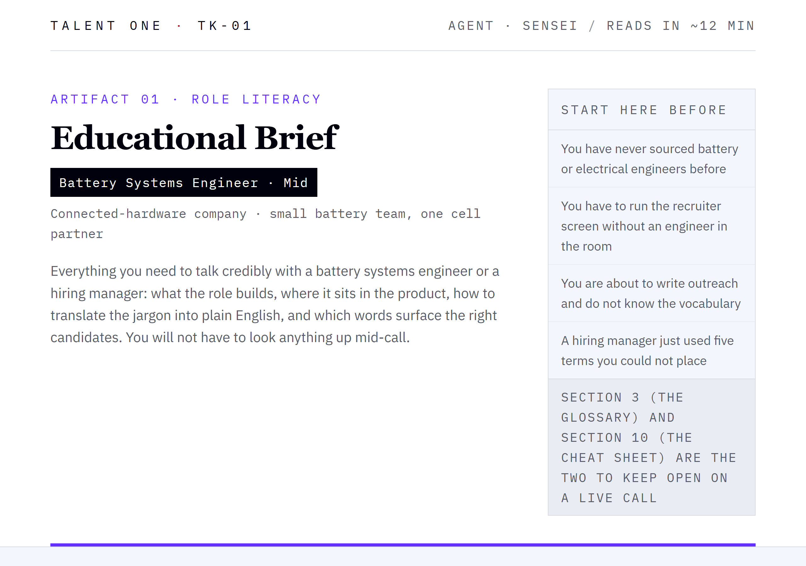
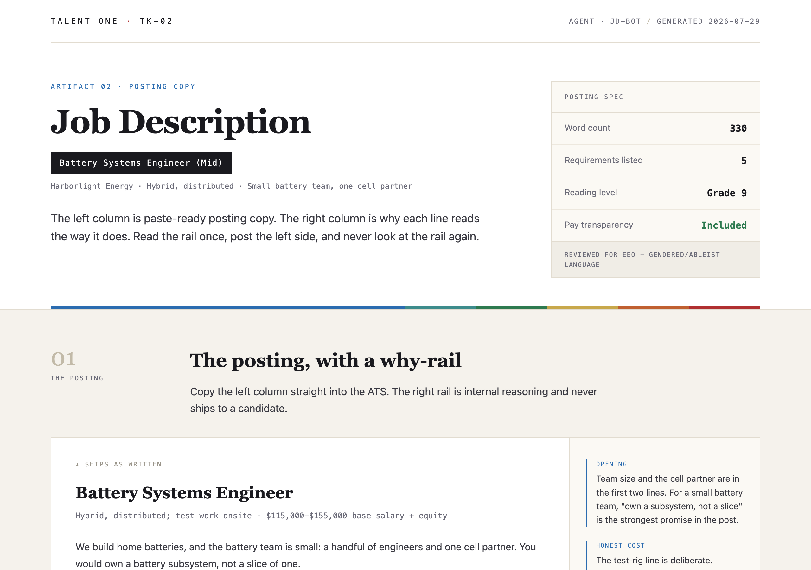
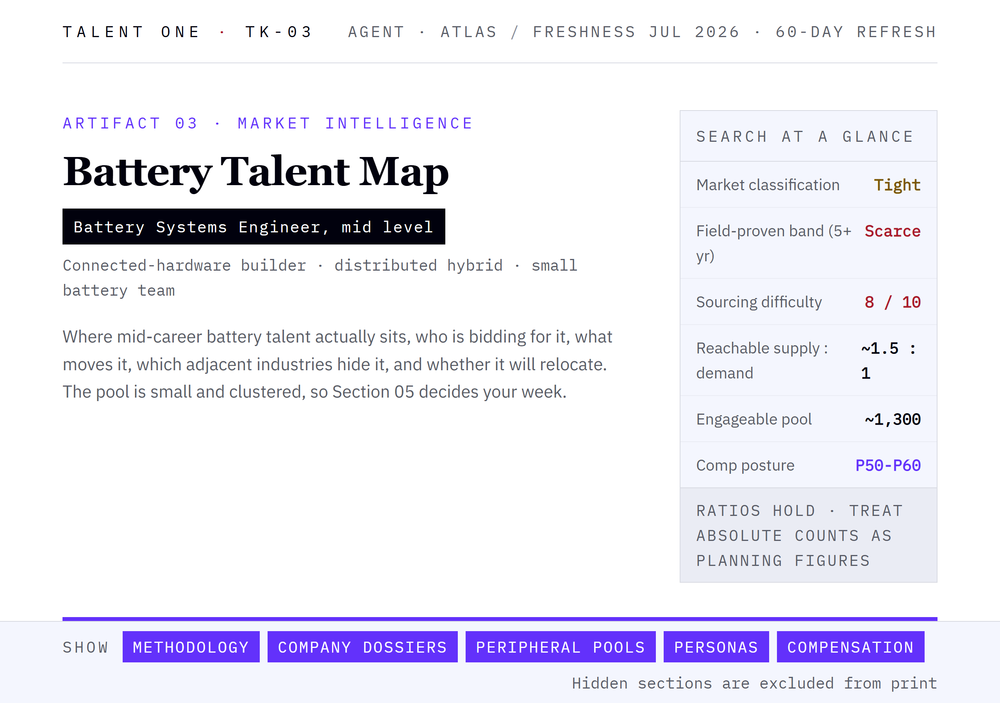
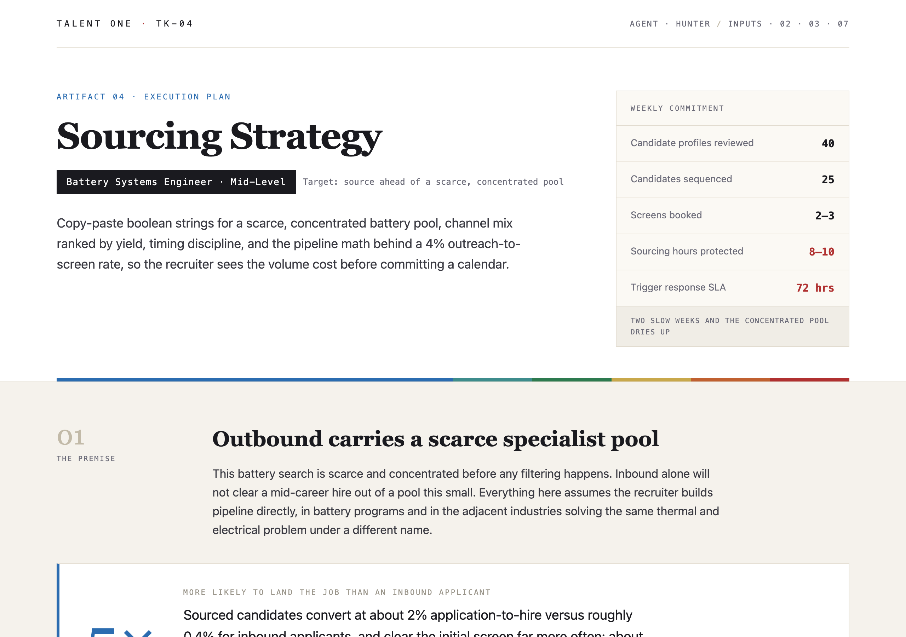
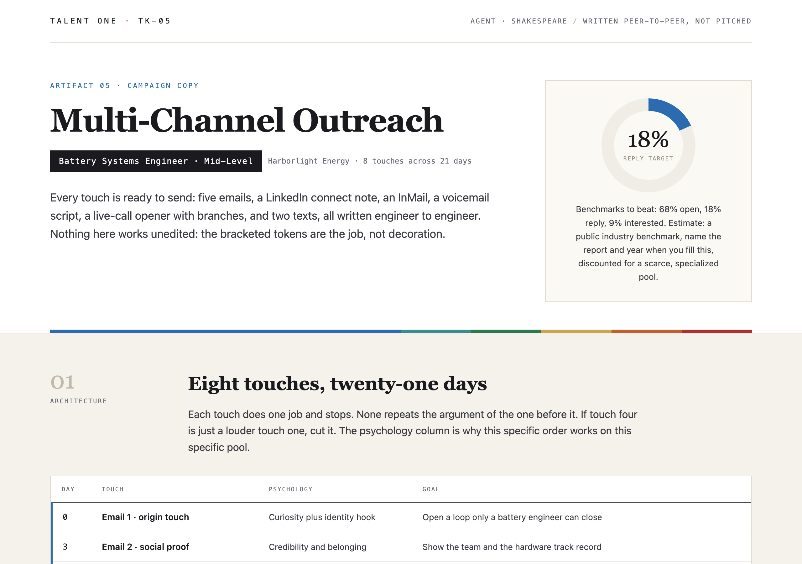
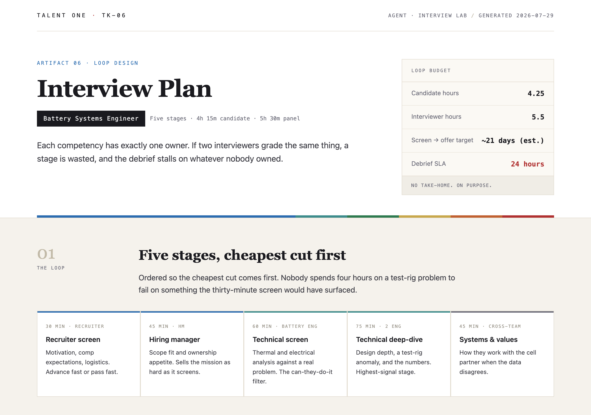
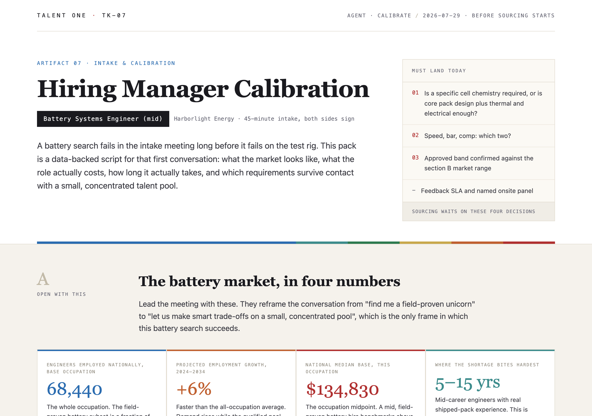
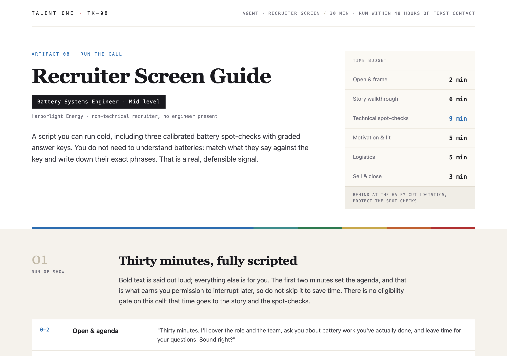

# How Talent One works

The detail behind the [README](../README.md): what each agent makes, how a run flows,
which model does what and what it costs, the data it can use, and the layout.

## What it makes

| # | Artifact | Agent | Sample |
| --- | --- | --- | --- |
| 01 | Role educational brief (for non-technical recruiters) | Sensei | [view](../samples/01_Role_Educational_Brief_SAMPLE.html) |
| 02 | Job description with annotation rail | JD-Bot | [view](../samples/02_Job_Description_SAMPLE.html) |
| 03 | Talent intelligence map: supply, demand, geography, comp | Atlas | [view](../samples/03_Talent_Intelligence_Map_SAMPLE.html) |
| 04 | Sourcing playbook with tiered boolean library | Hunter | [view](../samples/04_Sourcing_Playbook_SAMPLE.html) |
| 05 | 8-touch multi-channel outreach campaign | Shakespeare | [view](../samples/05_Outreach_Campaign_SAMPLE.html) |
| 06 | Interview plan with graded rubrics | Interview Lab | [view](../samples/06_Interview_Plan_SAMPLE.html) |
| 07 | Hiring-manager calibration brief | Calibrate | [view](../samples/07_HM_Calibration_Brief_SAMPLE.html) |
| 08 | 30-minute recruiter screen script | Recruiter Screen | [view](../samples/08_Recruiter_Screen_Script_SAMPLE.html) |
| 09 | Interviewer briefing and debrief | Interview Coach | not yet in the gallery |
| - | QA audit of the whole package | QA Gate | - |

Every artifact is a self-contained HTML document: no network requests, opens anywhere,
reads on a phone. Every number is tagged with where it came from: **Sourced**,
**Estimate** or **Internal**. Gaps are labeled, never filled with filler.

| You say | You get |
| --- | --- |
| `Run Talent One for a Senior ML Engineer` | The full nine-document kit, research and QA included, about 30 minutes in a recorded cold run |
| `Write me a JD for a staff accountant` | One document, minutes |
| `Update the comp band to $180k-$220k` | Re-rendered in about a second |

### Sample gallery

Eight documents rendered from the built-in worked example: a fictional search for a
Battery Systems Engineer at a fictional home-battery company, Harborlight Energy. The
company, the search and its figures are illustrative, not current market data. Click a
preview to open the full HTML.

<table>
<tr>
<td width="50%"><a href="../samples/01_Role_Educational_Brief_SAMPLE.html"></a><br><sub><b>01 · Role educational brief</b> · Sensei</sub></td>
<td width="50%"><a href="../samples/02_Job_Description_SAMPLE.html"></a><br><sub><b>02 · Job description + annotation rail</b> · JD-Bot</sub></td>
</tr>
<tr>
<td width="50%"><a href="../samples/03_Talent_Intelligence_Map_SAMPLE.html"></a><br><sub><b>03 · Talent intelligence map</b> · Atlas</sub></td>
<td width="50%"><a href="../samples/04_Sourcing_Playbook_SAMPLE.html"></a><br><sub><b>04 · Sourcing playbook</b> · Hunter</sub></td>
</tr>
<tr>
<td width="50%"><a href="../samples/05_Outreach_Campaign_SAMPLE.html"></a><br><sub><b>05 · Multi-channel outreach campaign</b> · Shakespeare</sub></td>
<td width="50%"><a href="../samples/06_Interview_Plan_SAMPLE.html"></a><br><sub><b>06 · Interview plan + graded rubrics</b> · Interview Lab</sub></td>
</tr>
<tr>
<td width="50%"><a href="../samples/07_HM_Calibration_Brief_SAMPLE.html"></a><br><sub><b>07 · Hiring-manager calibration brief</b> · Calibrate</sub></td>
<td width="50%"><a href="../samples/08_Recruiter_Screen_Script_SAMPLE.html"></a><br><sub><b>08 · Recruiter screen script</b> · Recruiter Screen</sub></td>
</tr>
</table>

Previews are screenshots (`bash assets/src/screenshots.sh` rebuilds them). GitHub shows
`.html` as source, so use the raw or download view, or clone the repository, to see the
live document.

## How a run flows

One research pass per role builds a **Context Pack**, a shared research summary: market
classification, one canonical comp range, requirements, keywords, personas, channels,
targets and timing, each value tagged with where it came from.

Then every requested artifact agent runs **in parallel** against that pack, producing
content only. **Critic** runs one adversarial pass per artifact before anything renders.
A deterministic renderer assembles each document from a fixed template, so the format
is always the same. **QA Gate** checks the whole package against the pack before it is
called done. You talk to the session skill; it calls Relay twice (`mode: plan`, then
`mode: execute`), never the workers. You never call Relay, Scout, Critic or QA Gate
yourself.

In the agents' own names: Relay plans and asks, Scout builds the Context Pack; Sensei,
JD-Bot, Atlas, Hunter, Shakespeare, Interview Lab, Calibrate, Recruiter Screen and
Interview Coach draft in parallel on Sonnet; Critic (Opus) reviews each draft with at
most two repair laps; the renderer formats and verifies; QA Gate (Opus) audits any
package of two or more documents, also with at most two repair laps.

## Model tiers and cost

Relay plans and runs the loop on the orchestrator tier (Fable). Every artifact agent and
Scout produce on the executor tier (Sonnet). Critic and QA Gate judge on the verifier
tier (Opus), and the model that made a thing never checks it.

A cold nine-artifact run is roughly 10 Sonnet calls (Scout plus the nine producers), 11
Opus calls (one pack Critic pass, nine per-artifact Critic passes, one QA Gate pass) and
2 Fable calls (Relay plan and execute), **before repair laps**. The 2 Fable calls are a
floor: Relay adds one for each question it has to bring back to you. Each repair lap
re-runs a producer and its checker, so a run with laps costs more. The extra Opus calls
provide a separate review before rendering. They cannot guarantee truth: check
sources and complete the account-specific acceptance cases before using real output.

**Timing.** The full kit took about 30 minutes in a recorded cold run, most of it Scout's
research pass; nothing enforces that figure. One artifact on a warm role takes minutes.
Changing a number later re-renders in seconds.

Anything you already hold (a JD, intake notes, comp data, a brain dump) shortens the
pack build. A paste-ready deep-research prompt
(`skills/talent-one/references/PACK_RESEARCH_PROMPT.md`) lets you build the pack in any
Claude chat and hand it in as a file.

## Data and connectors

Without an ATS connection, the kit can research public sources such as BLS, O\*NET,
Census and public postings when the host provides web tools. Supplied source files
can fill gaps. The bundled baseline is an archived snapshot, not verified current
market data; missing evidence must remain unresolved.

Four optional remote connectors ship in `.mcp.json`: **Exa** and **Bright Data** for the
public web, **Greenhouse** and **Ashby** for your own ATS. Nothing is sent to one until
you sign in, and each agent may call only the tools its file names. Setup, scopes and
privacy rules: [CONNECTORS.md](../CONNECTORS.md).

Constraints (work authorization, licensure, background checks) are recruiter-written,
rendered verbatim and never invented. An empty constraints list ships no eligibility
gate at all.

## Branding

Setup's `## Brand` section sets the artifact code prefix and the footer credit. The
renderer owns that chrome: `render.py render --prefix <code>` sets the mark and footer
(default `TK`, so documents read `TK-01` to `TK-09`), and `--credit on|off` keeps or
drops the footer credit "Built with Talent One by OnePromptMan" (default on).

## What the plugin can touch

The plugin contains prompts, templates and Python scripts. Its local renderer makes
no network calls; model sessions and research connectors use their providers. In
Cowork the scripts run inside Claude's sandbox; in
Claude Code they run on your computer through Claude's Bash tool. The renderer's one
Python package, beautifulsoup4, ships inside the plugin, so nothing is installed at run
time. A content fragment cannot carry a script, an
event handler, a remote image or a frame into a rendered document: the renderer keeps
only inline formatting, and its verify step flags any active content as HIGH.

`build-plugin.sh` is only for surfaces that take a plugin upload; the marketplace
install needs none of it. Built plugins are not committed.

## Layout

```
.claude-plugin/     plugin.json and marketplace.json (one marketplace, named talent-one)
.mcp.json           the four optional remote connectors
agents/             agent definitions: relay, scout, the nine artifact specialists,
                    oracle, pforge, critic, qa-gate
skills/             the full kit, one skill per artifact, funnel diagnosis, setup, and
                    the QA audit
samples/            eight documents from the built-in worked example
evals/              acceptance gate and model evals
runner/             headless runner (claude -p) and the aggregate ATS fetcher
tools/              structural validators for the DAG, the fill contract and the slot schema
tests/              the renderer and manifest tests (python -m pytest -q tests)
docs/               install guide, this page and 1.0.3 release notes
requirements-dev.txt  pytest, for the tests (the renderer's one package ships in
                    skills/talent-one/scripts/_vendor/)
```

More: [install guide](INSTALL.md) for each surface, [connectors](../CONNECTORS.md),
[changelog](../CHANGELOG.md) and [release notes 1.0.3](RELEASE_NOTES_1.0.3.md) (kept for
history).

## What 2.x supersedes

Talent One 1.x, the sequential, content-in-HTML predecessor of this kit; 2.1 carries its
1.1.x features forward. This repository starts a fresh history at 2.1.0, and the 1.x
history is not part of it. The same roster also runs outside Claude Code: its paste-in
editions for Claude Projects and custom GPTs and its n8n swarm are published separately as
onepromptman/dag-talent-agents. Oracle is the `oracle` agent behind the
`talent-one-funnel` skill (its benchmark-retrieval discipline also lives in Scout), Pforge
is the `pforge` agent, and Interview Coach's seven coaching dimensions became artifact
09.
